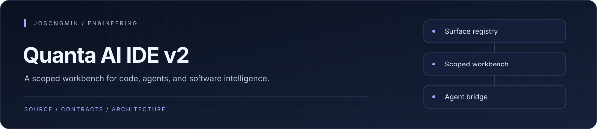
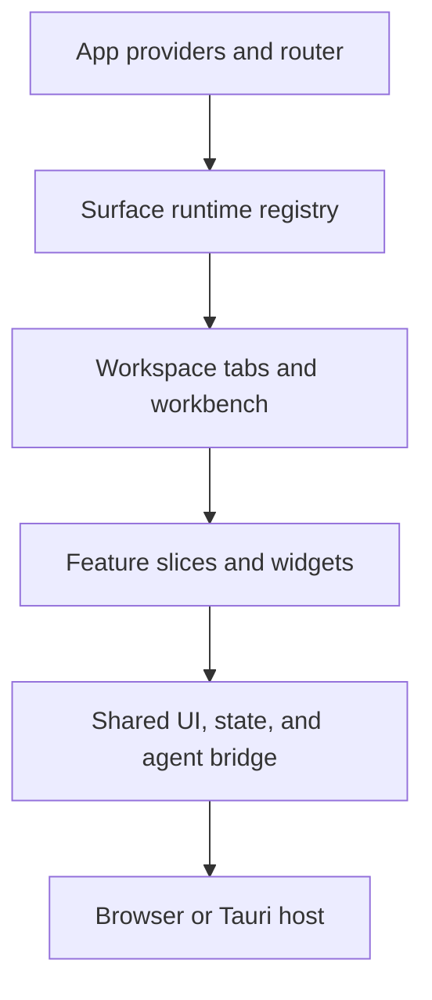

<p align="center"></p>

# Quanta AI IDE v2

A codebase visualization workbench for exploring repositories as spatial systems. React and TypeScript provide the interface, Three.js renders the scene, Zustand manages state, and Tauri supplies the optional desktop shell.


## Engineering highlights

| Mechanism | Engineering purpose |
| :--- | :--- |
| **Registered workspace surfaces** | The app composes a surface runtime and route registry; workspace features consume that registry through context. |
| **Scoped workbench infrastructure** | Shared workbench and UI infrastructure own scope, keybindings, overlays, and cleanup concerns. |
| **Agent integration boundary** | Agent-session integration lives behind the app and shared bridge layers, keeping the presentation surface distinct from the agent runtime. |
| **Architecture and UI checks** | Import-boundary audits, UI-infrastructure checks, catalog validation, renderer tests, and bundle budgets have separate scripts. |


## Architecture at a glance



## What it does

- Explore files and targets through a 3D dot field and alternate visualization modes.
- Filter the workspace, inspect selected targets, and overlay code metrics.
- Compose workspace, organization, personal settings, and agent activity screens.
- Inspect components with Storybook and verify browser rendering, UI infrastructure, and bundle budgets.

## Repository map

| Path | Responsibility |
| --- | --- |
| [src/app](src/app) | Application entry and global composition. |
| [src/widgets](src/widgets) | Workbench regions and screen composition. |
| [src/features](src/features) | User actions and feature workflows. |
| [src/entities](src/entities) | Domain data and models. |
| [src/shared](src/shared) | UI, rendering, and shared workbench infrastructure. |
| [docs](docs) | Catalog, specifications, and design decisions. |

## Run locally

Use Node.js >=20 and pnpm@10.33.0. Run these commands from the repository root.

```sh
pnpm install --frozen-lockfile
pnpm dev
```

## Development checks

```sh
pnpm typecheck
pnpm lint
pnpm test
pnpm build
```

### Desktop and UI verification

```sh
pnpm tauri:dev
pnpm test:renderer
pnpm verify
```

Desktop development requires Rust and platform build dependencies. Renderer tests require a browser environment. `package.json` defines the exact verification pipeline.

## Scope and status

This repository develops the visualization and interaction surfaces. Demonstration metrics are separate from measurements produced by a connected analysis engine. Web, browser-renderer, and desktop checks cover different execution paths.

## Documentation

- [Feature catalog](docs/catalog.md)
- [Workbench handoff](docs/workbench-handoff.md)
- [Design RFCs](docs/rfc)
- [Script reference](package.json)
