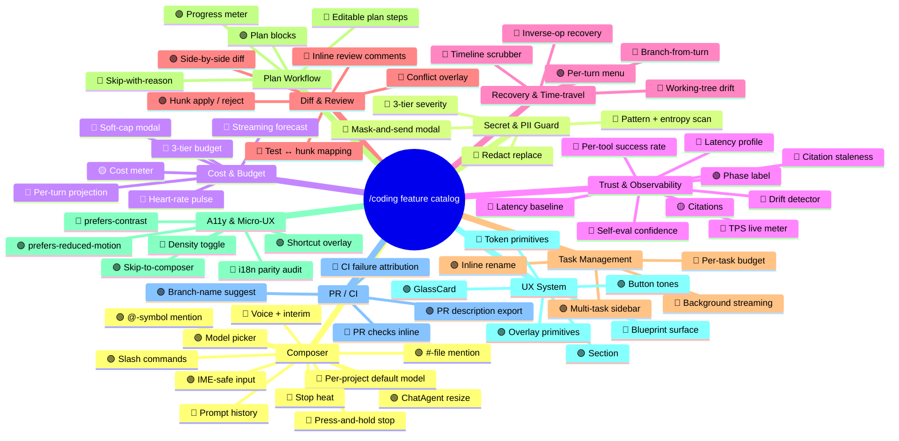

# Feature Catalog

Single source of truth for the `/coding` workspace's feature inventory.

Each feature is one entry in a YAML file under `catalog/families/`. Features
are grouped by **family** (Composer, Secret Guard, Cost & Budget, …). The
catalog drives:

- **Marketing copy** — bullet lists, comparison tables, launch posts
- **Onboarding** — what's new since v.X
- **SOTA benchmarking** — gap analysis against Cursor / Claude Code / Devin /
  OpenHands / Cody / Continue / Windsurf / Copilot Workspace
- **Audit** — every catalog entry must point at a real symbol or test in
  the repo (orphan detection prevents copy-paste drift)

## Why YAML

- Human-grep-friendly. `rg "id: voice-interim"` lands you in seconds.
- Diff-friendly review: features land one entry at a time.
- Schema-validated via Pydantic so a missing field fails CI, not at render
  time.
- Each family is a separate file so two PRs touching different families
  don't conflict.

## Why Python

The repo's other tooling lives in `scripts/*.mjs` (i18n audit, bundle
budget). Feature catalog is heavier: schema validation, multi-format
rendering, orphan checking against TS source. Pydantic + Typer + Rich
make the CLI clean without a bespoke runtime.

## Layout

```
tools/feature-catalog/
├── catalog/
│   ├── _schema.yaml           # feature schema mirror (docs)
│   ├── _families.yaml         # family metadata (id → label, order)
│   ├── families/*.yaml        # one file per family, list of features
│   └── sota-snapshot.yaml     # competitor matrix
├── src/feature_catalog/       # Pydantic models + CLI
└── tests/
```

## Quick start

```sh
cd tools/feature-catalog
pip install -e .
fcat validate                  # schema + cross-refs
fcat list                      # one line per feature
fcat list --family composer    # filter
fcat list --tier leading       # only leading-edge
fcat show voice-interim        # full detail
fcat coverage                  # SOTA gap matrix
fcat render --format=md > catalog.md
fcat render --format=mermaid > catalog.mmd
fcat audit                     # orphan detection (catalog ↔ source)
```

## CI hook

Wired into the parent `package.json`:

```json
"catalog:validate": "python3 -m feature_catalog validate --root tools/feature-catalog/catalog",
"catalog:audit":    "python3 -m feature_catalog audit    --root tools/feature-catalog/catalog",
"catalog:render":   "python3 -m feature_catalog render   --root tools/feature-catalog/catalog --format md",
"verify":           "pnpm typecheck && pnpm lint && pnpm semgrep:ci && pnpm catalog:validate"
```

The `verify` script gates `catalog:validate` alongside typecheck / lint
/ semgrep, and `.github/workflows/catalog.yml` runs validate + audit
+ pytest on every PR plus a stale-snapshot check (regenerates
`CATALOG.md` / `COVERAGE.md` and fails if the diff is non-empty).

## Mind-map

Auto-generated from the catalog. Renders natively on GitHub.



(Run `pnpm catalog:render` and replace the block above when the catalog
shifts. The full machine-rendered mind-map lives in `CATALOG.mmd`.)

## Tier definitions

| Tier | Meaning |
|------|---------|
| `leading`    | No competing IDE has it, or our depth is unique. |
| `parity`     | Match the strongest SOTA tool (Cursor / Claude Code / Devin / …). |
| `progressive`| Some SOTA tool has it; we're at a similar depth. |
| `table-stakes` | Universal — present in every modern IDE. |

## Adding a feature

1. Pick the family file (e.g. `catalog/families/composer.yaml`).
2. Append an entry. Required fields: `id`, `label`, `tier`, `description`,
   `evidence`, `pattern`. See `catalog/_schema.yaml` for the full shape.
3. Run `fcat validate` — the CLI tells you what's missing.
4. Run `fcat audit` — confirms `evidence.symbols` resolve in source.
5. PR. Reviewers can scan the YAML diff in seconds.
